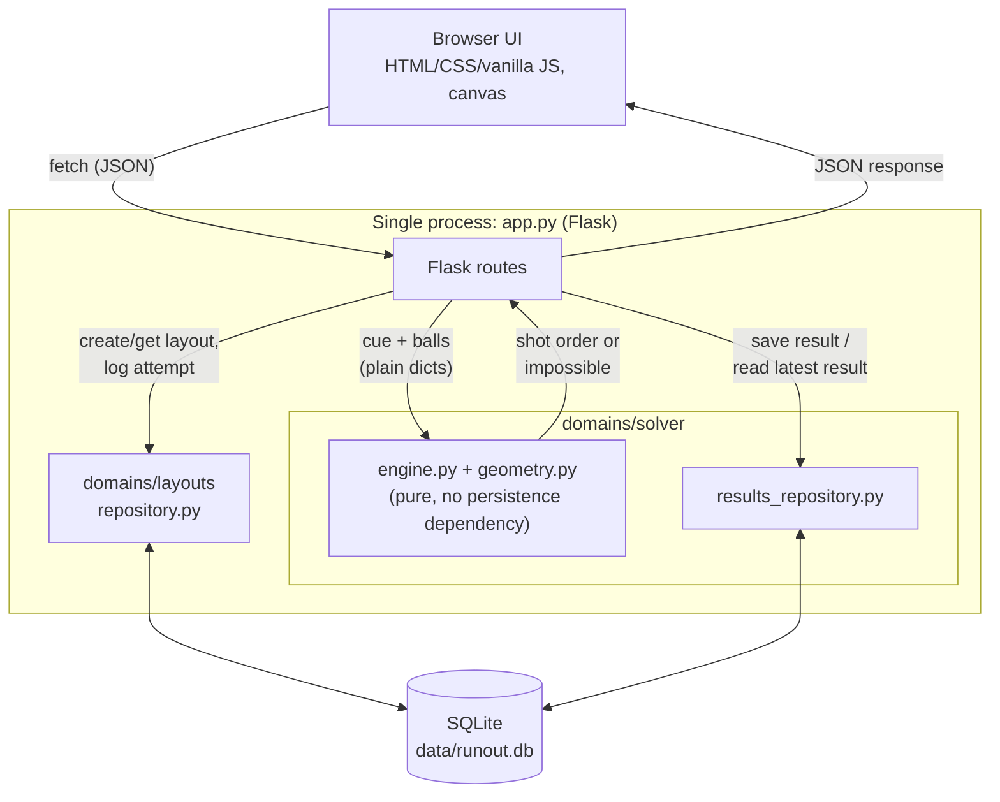
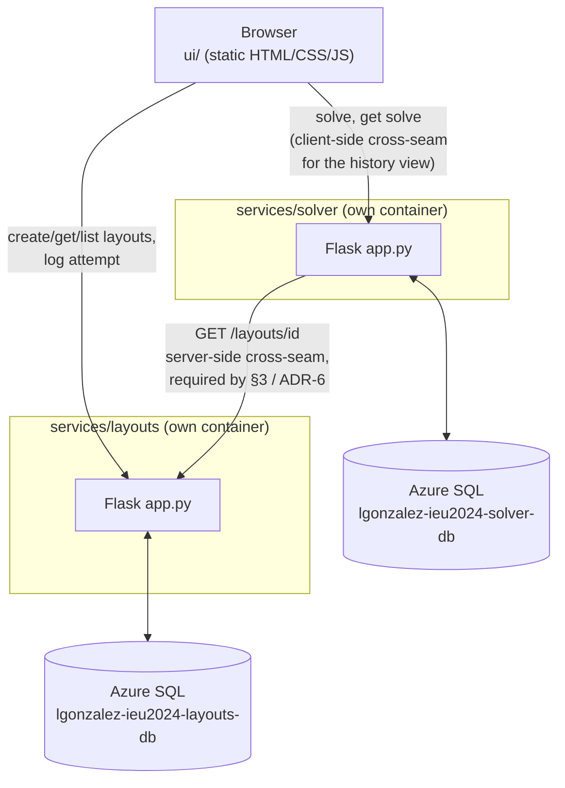
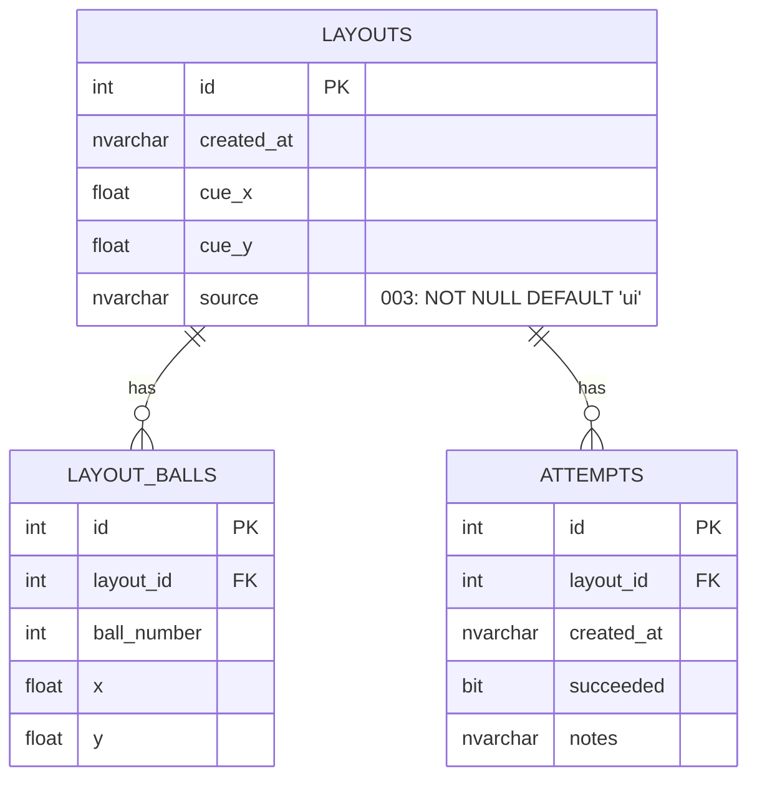
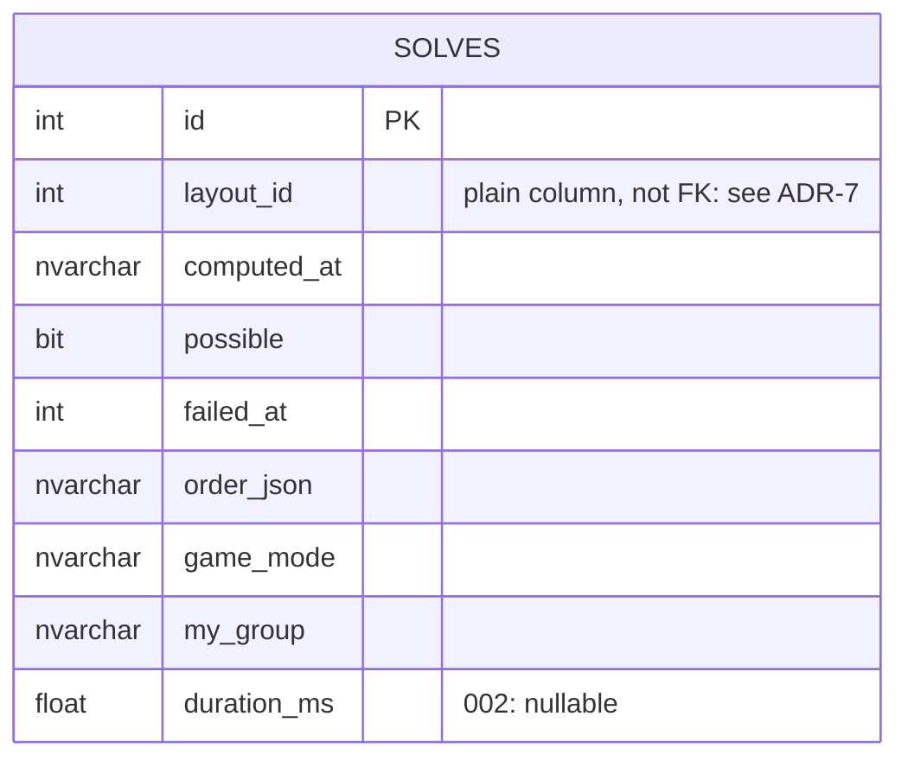
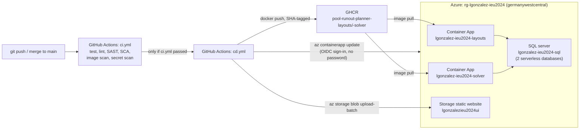

# Diagrams

Source diagrams for the report (§8b). Kept as Mermaid so they render directly on GitHub and stay versioned alongside the code they describe.

## Architecture, before (Assignment 1 monolith)

Matches [ADR-2](../ADR.md): the algorithm itself (`engine.py` + `geometry.py`) never touches the database and stays unit-testable without one, but the solver domain owns a separate `results_repository.py` that saves and re-reads its own computed results, symmetric with how `domains/layouts` owns its own persistence.

## Architecture, after (Assignment 2 split)

Matches [ADR-6](../ADR.md): the seam from ADR-2 held, and `solver`'s call to `layouts` is the one required server-side cross-seam flow (§3). Each service is its own process, its own container, its own Azure SQL database; the UI is static files calling both directly from the browser.

## Database schema: layouts service

Matches [ADR-3](../ADR.md) (the child-table shape) and `services/layouts/migrations/001_init.sql` + `003_add_layout_source.sql`. `layout_id` in both child tables is a real foreign key, since both tables live in the same database.

## Database schema: solver service

Matches [ADR-6](../ADR.md)/[ADR-7](../ADR.md) and `services/solver/migrations/001_init.sql` + `002_add_solve_duration.sql`. `layout_id` is a plain column here, not a foreign key: `layouts` lives in a different database, so SQL Server has no way to enforce it. Integrity is handled in code instead, `solver` only ever writes a row here after successfully reading that exact layout back from `layouts` over HTTP.

## Deployment

Matches [ADR-8](../ADR.md). Every merge to `main` runs `cd.yml` automatically; nothing here is deployed by hand after the one-time initial setup (README).

